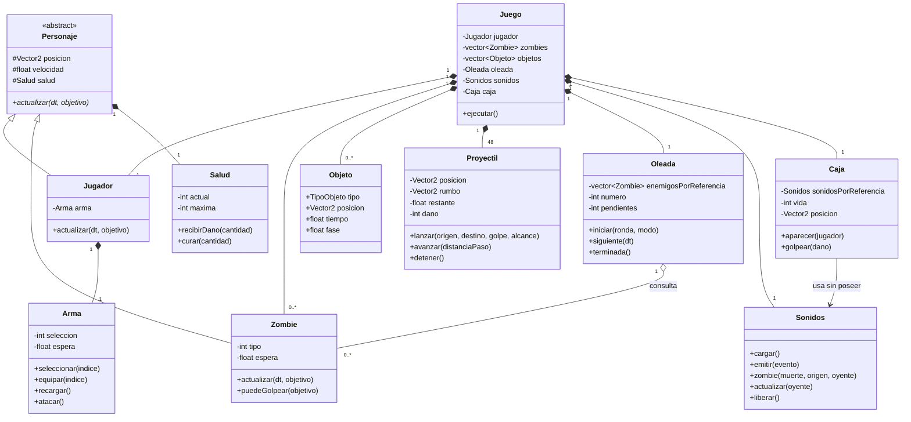

# Informe del avance del videojuego

**Universidad Peruana Cayetano Heredia**  
**Curso:** Programación Orientada a Objetos  
**Ciclo:** 2026-2  

**Integrantes**

- Kenneth Samir Ramos Espinoza
- Giordano Valentino Valero Bonifacio
- Leonardo Pedro Espinoza Flores
- Leonel Willians Sotelo Mamani

## I Resumen ejecutivo

Desarrollamos ZZZombies, un videojuego 2D de supervivencia frente a oleadas de zombis.  
En este avance presentamos movimiento, combate, armas, cajas, recogibles y dos modos de dificultad.  
Organizamos la versión en once clases principales con responsabilidades vinculadas a la partida.  
Aplicamos herencia, polimorfismo, encapsulamiento, composición, agregación y asociación.  
La implementación utiliza C++17 y raylib, con una escena urbana y personajes animados.  
El prototipo establece la base jugable; los dos patrones de diseño siguen pendientes para la entrega final.

## II Introducción

### Contexto y objetivo

ZZZombies nace de la temática Ciudad Zombie propuesta en el curso. El jugador debe sobrevivir a enemigos que aparecen por oleadas y aprovechar las armas y botiquines que encuentra durante la partida. Elegimos esta idea porque permite relacionar las decisiones de programación con acciones concretas: moverse, atacar, recibir daño, recoger un objeto y avanzar a la siguiente ronda.

Nos entusiasma presentar una versión que ya puede jugarse de principio a fin: entrar al menú, iniciar una partida, enfrentar enemigos y volver a intentarlo después de perder. Para este avance nos concentramos en que ese recorrido funcione y en que la organización del código sea comprensible para el equipo.

Nuestro objetivo es construir una base de juego que permita demostrar los fundamentos de la programación orientada a objetos. Cada clase tiene una responsabilidad reconocible y participa en el funcionamiento de la partida. Las características de etapas posteriores se incorporarán sobre esta base.

### Tecnologías utilizadas

| Tecnología | Uso en el proyecto |
|---|---|
| C++17 | Implementación de clases, reglas, controles y lógica de la partida. |
| raylib | Creación de la ventana, lectura de controles, dibujo de imágenes y reproducción de audio. |
| MSYS2 y MinGW de 32 bits | Compilación del código y enlace con la biblioteca raylib incluida. |
| Git y GitHub | Repositorio del proyecto y registro de las revisiones que publique el equipo. |
| PNG y WAV | Recursos gráficos y efectos de sonido utilizados por el juego. |

### Alcance de esta entrega

La versión parcial conserva un escenario urbano, un jugador animado y tres tipos de zombi: normal, rápido y pesado. Incluye espada, pistola y AK, además de cajas que entregan recogibles. La vida, la munición, las eliminaciones y el número de oleada se muestran durante el combate.

Presentamos esta versión como la base funcional del avance del 25 %. En esta entrega nos concentramos en el recorrido de una partida y en las relaciones entre sus clases. Los eventos adicionales, los jefes y otras ampliaciones de contenido corresponden a etapas posteriores.

## III Diseño de arquitectura

### Organización del proyecto

La versión utiliza dos archivos principales. `Clases.cpp` contiene las clases que ejecutan el juego y las funciones de apoyo para movimiento, colisiones y dibujo. `Variables.h` reúne los valores de configuración, las rutas de los recursos y la distribución del mapa.

Las imágenes y los sonidos se encuentran en `assets`. La dependencia raylib se conserva en `vendor`, junto con su licencia. `Compilar.cmd` genera el ejecutable y `Jugar.cmd` lo abre. Si el ejecutable todavía no existe, `Jugar.cmd` llama primero al proceso de compilación.

### Responsabilidad de las clases

La arquitectura contiene once clases principales de funcionamiento. Las clases de datos de `Variables.h` y la ficha auxiliar que ordena el dibujo no se incluyen en este conteo.

| Clase | Responsabilidad dentro de la partida |
|---|---|
| `Juego` | Coordina las pantallas, los controles, los recursos y las interacciones del combate. |
| `Personaje` | Define la base común de posición, movimiento, animación y salud. |
| `Jugador` | Interpreta los controles y administra el arma disponible para atacar. |
| `Zombie` | Persigue al jugador y controla cuándo puede golpearlo. Su tipo determina sus estadísticas y su imagen. |
| `Salud` | Mantiene la vida actual y máxima, y aplica daño o curación dentro de esos límites. |
| `Arma` | Controla la selección, las armas obtenidas, la munición y la espera entre ataques. |
| `Proyectil` | Representa una bala en movimiento, con dirección, daño y alcance restante. |
| `Objeto` | Guarda el tipo, la posición y la duración de un recogible en el suelo. |
| `Caja` | Controla su aparición, posición y resistencia, y notifica su destrucción al sistema de sonido. |
| `Oleada` | Define la cantidad y el ritmo de aparición de enemigos y consulta cuándo termina la ronda. |
| `Sonidos` | Carga los efectos, reproduce los eventos y administra las voces de los zombis cercanos. |

La clase `Juego` conserva la coordinación general. Las reglas particulares de salud, armas, enemigos y oleadas están distribuidas en sus respectivas clases. Esta separación nos permite ubicar una regla sin recorrer todo el archivo: por ejemplo, la espera entre disparos pertenece a `Arma` y el ritmo de aparición pertenece a `Oleada`.

### Diagrama de clases

El siguiente UML muestra las clases principales y sus relaciones. Se omiten los detalles de dibujo y los métodos de consulta para mantener legible la arquitectura.



En el diagrama, el rombo lleno representa composición y el rombo vacío representa agregación. Las referencias de `Oleada` y `Caja` se reciben mediante sus constructores; esos objetos no crean una segunda lista de enemigos ni otro sistema de sonido.

## IV Aplicación de fundamentos de POO

### Asociación

`Caja` utiliza el objeto `Sonidos` que le entrega `Juego`. Cuando la caja se destruye, solicita la reproducción de un efecto. Mantuvimos el audio en una clase propia para que la caja no tenga que cargar archivos ni administrar el dispositivo de sonido.

La relación queda expresada en el atributo `Sonidos &sonidos` y en el constructor `Caja(Sonidos &audio)`. La caja conoce el servicio que utiliza, pero no es su propietaria.

### Agregación

`Oleada` conserva una referencia a la lista de zombis administrada por `Juego`. Esa lista ya existe cuando se construye la oleada. La clase la consulta para contar enemigos vivos y determinar si puede terminar la ronda.

La lista sigue perteneciendo a `Juego`: es allí donde aparecen los enemigos y se retiran los derrotados. Esta relación permite que `Oleada` conozca el estado del combate sin mantener una copia de los enemigos.

### Composición

Cada personaje contiene su propia `Salud`, y `Jugador` contiene su propia `Arma`. Estos objetos forman parte de sus propietarios y se crean junto con ellos. Por ejemplo, reiniciar al jugador también restablece su salud y su estado de armas.

`Juego` contiene, a su vez, los componentes necesarios para ejecutar una partida. La composición expresa qué datos y objetos forman parte del estado de ese juego.

### Herencia y polimorfismo

`Jugador` y `Zombie` derivan de `Personaje`. Ambos comparten posición, salud y animación, pero realizan acciones distintas al actualizarse. El jugador interpreta el teclado y resuelve su movimiento; el zombi calcula una dirección hacia el objetivo y avanza para perseguirlo.

`Personaje` declara `actualizar()` como método virtual puro. La función `actualizarPersonaje()` recibe una referencia a esa clase base y realiza una única llamada al método. La implementación ejecutada depende de si recibió un jugador o un zombi. Así utilizamos el polimorfismo durante el combate, además de declarar la jerarquía de clases.

### Encapsulamiento y abstracción

La vida actual y máxima son atributos privados de `Salud`. El daño se aplica con `recibirDano()` y la curación con `curar()`. Estas operaciones mantienen la vida entre cero y su máximo. El resto del juego puede consultar el resultado sin cambiar directamente esos atributos.

En `Arma`, la selección, la munición y la espera entre ataques también son privadas. El método `atacar()` comprueba si puede realizarse la acción y descuenta una bala cuando corresponde. Con esta organización, `Juego` solicita el ataque y utiliza su resultado sin repetir la validación de munición en cada llamada.

La clase abstracta `Personaje` reúne el comportamiento que comparten los actores. Nos permite trabajar con una representación común y mantener las diferencias de controles y persecución en las clases derivadas.

## V Implementación de resultados parciales

### Recorrido de una partida

El menú presenta el nombre ZZZombies y permite iniciar una partida normal, elegir el modo imposible o salir. Al comenzar, el jugador aparece en el escenario urbano y la cámara lo sigue dentro de los límites del mapa.

Durante el combate, el jugador se mueve con WASD o las flechas. El clic izquierdo dirige el ataque hacia el cursor y la barra espaciadora permite atacar hacia el enemigo vivo más cercano. Los tres espacios de armas se seleccionan con las teclas 1, 2 y 3 o mediante clic.

La espada realiza un ataque de corto alcance. La pistola y el AK consumen munición y lanzan balas visibles que recorren el escenario. Las balas se detienen al impactar con un enemigo, una caja, un obstáculo o el límite del mapa. Su movimiento se comprueba en pasos pequeños para evitar que atraviesen obstáculos entre dos actualizaciones.

Las cajas pueden romperse con ataques y entregan un recogible. Sus opciones incluyen botiquines, munición y armas que el jugador todavía no ha obtenido. Los botiquines recuperan hasta cuatro puntos de vida y la munición rellena las armas de fuego obtenidas. Si no se necesita la curación o la munición, el objeto permanece disponible hasta que termine su duración.

La siguiente oleada comienza cuando no quedan enemigos vivos ni pendientes de aparecer. También conservamos el botón SKIP, que permite adelantar una ronda sin eliminar a los enemigos que siguen vivos. Tiene una espera de tres segundos entre usos.

Cuando la vida del jugador llega a cero, se detiene el combate y aparece el mensaje «Has muerto» sobre la escena. Desde allí se puede reiniciar o regresar al menú. Este recorrido nos permite presentar una partida completa y comprobar cómo se relacionan sus componentes.

### Enemigos y dificultad

| Tipo de zombi | Comportamiento en esta versión |
|---|---|
| Normal | Persigue al jugador con estadísticas intermedias. |
| Rápido | Se desplaza más rápido, con menor vida inicial. |
| Pesado | Tiene mayor resistencia y daño, con menor velocidad. |

En modo normal, los rápidos pueden aparecer desde la tercera oleada y los pesados desde la quinta. En modo imposible, los tres tipos están disponibles desde el inicio, aumenta la cantidad de enemigos y la espera entre apariciones se reduce un 30 % respecto al cálculo del modo normal. Además, la vida de los zombis aumenta con el número de oleada en ambos modos.

### Interfaz y audio

La interfaz muestra la vida, las eliminaciones, la oleada, el modo, los enemigos activos y pendientes, el arma seleccionada y su munición. El mapa conserva sus elementos urbanos y la superposición de personajes y obstáculos según su posición vertical.

Los efectos acompañan ataques, disparos, daño, cambios de arma y transiciones de la partida. Los gemidos y las muertes de zombis se reproducen a una distancia máxima de 180 unidades. Cada uno de esos dos efectos dispone de cinco voces compartidas; no se crea un reproductor por enemigo.

### Comprobaciones realizadas

La versión se compiló con las advertencias del compilador activadas. También se comprobó el funcionamiento de los controles, el cambio de armas, la munición, los impactos, los recogibles y el reinicio. Se verificó que los clics sobre la interfaz no dispararan al volver al mapa con el botón todavía presionado.

Se revisaron los dos modos y la detención de la escena al perder. Las imágenes y los sonidos se probaron desde una copia de la carpeta ubicada en otra ruta. Estas comprobaciones respaldan el avance presentado, aunque el equilibrio de dificultad y las sesiones prolongadas seguirán revisándose durante el desarrollo.

### Versionamiento y trabajo del equipo

El repositorio del proyecto se encuentra en:

<https://github.com/leonardoespinoza-ui/Poo-Proyect-Game---Zzzombies>

Esta entrega incorpora al repositorio la versión parcial, sus recursos, la dependencia raylib y este informe. El historial conserva la versión inicial y registra esta actualización. Todavía falta evidencia de aportes individuales de todos los integrantes; una publicación conjunta no acredita por sí sola el trabajo colaborativo durante todo el desarrollo.

Para las siguientes revisiones registraremos los cambios de funcionalidad con mensajes concretos y mantendremos el código y los recursos utilizados en el repositorio. El ejecutable se genera al compilar. La evidencia de participación se sustentará en el historial real de cambios de cada integrante, sin atribuir tareas o revisiones que aún no estén registradas.

## VI Conclusiones

Con este avance conseguimos una base jugable que conecta el movimiento, la persecución, el combate y la obtención de recursos. Ya podemos observar cómo una decisión del jugador modifica la partida: cambiar de arma consume otra reserva de munición, romper una caja crea un objeto y derrotar enemigos permite avanzar de oleada.

El trabajo nos permitió dar una responsabilidad concreta a cada clase. La herencia reúne los elementos comunes de los personajes, mientras que la composición conserva la salud y el arma dentro de los objetos que las utilizan. La agregación y la asociación permiten consultar o utilizar componentes existentes sin duplicarlos.

Una dificultad importante fue mantener el alcance de esta etapa. Optamos por presentar tres tipos de zombi y un conjunto pequeño de armas, conservando la apariencia del escenario. Esta decisión nos deja un código que podemos revisar y explicar antes de incorporar nuevas mecánicas.

Para la siguiente etapa trabajaremos en el equilibrio de las oleadas, los eventos y los enemigos especiales. También queda pendiente integrar y justificar los dos patrones de diseño solicitados para el proyecto final. Evaluaremos State para separar la lógica de las pantallas y Factory Method para la creación de enemigos. En esta versión, los estados se resuelven con una enumeración y la creación de zombis se realiza directamente; todavía no presentamos esas implementaciones como los patrones completos.

Nos interesa que la siguiente entrega mantenga la claridad de esta base y que las nuevas funciones puedan demostrarse en una partida, junto con su implementación en el código.

## VII Anexos

### A Herencia y actualización polimórfica

Fragmentos de la clase base y de la función utilizada para actualizar los personajes:

```cpp
virtual ~Personaje() = default;
virtual void actualizar(float dt, Vector2 objetivo) = 0;
```

```cpp
void actualizarPersonaje(Personaje &personaje, float dt, Vector2 objetivo)
{
    personaje.actualizar(dt, objetivo);
}
```

`Jugador` y `Zombie` implementan sus respectivos métodos `actualizar()` con `override`.

### B Protección de la salud

Fragmento de la implementación de `Salud`:

```cpp
private:
    int actual;
    int maxima;
public:
    void recibirDano(int cantidad) { actual = std::max(0, actual - cantidad); }
    void curar(int cantidad) { actual = std::min(maxima, actual + cantidad); }
```

### C Referencias a componentes existentes

Fragmentos que expresan la agregación de enemigos y la asociación con el audio:

```cpp
const std::vector<Zombie> &enemigos;
Oleada(const std::vector<Zombie> &lista) : enemigos(lista) {}
```

```cpp
Sonidos &sonidos;
Caja(Sonidos &audio) : sonidos(audio) {}
```

En `Juego`, ambas referencias se conectan con los objetos que ya administra:

```cpp
Juego() : oleada(zombies), caja(sonidos) {}
```

### D Ejecución del juego

Para compilar se utiliza `Compilar.cmd`, con MSYS2 y MinGW de 32 bits instalados en `C:\msys64\mingw32`. Después se ejecuta `Jugar.cmd`. Cuando se modifica el código, se vuelve a compilar antes de abrir la nueva versión.

El ejecutable debe mantenerse junto a la carpeta `assets`. La carpeta `vendor` contiene la dependencia necesaria para compilar y su licencia. Los archivos del informe no forman parte de la ejecución del juego.

### E Detalles de implementación

El arreglo `Proyectil proyectiles[Datos::maxBalas]` contiene 48 proyectiles desde la creación de `Juego`; entre cero y 48 pueden estar activos. Esa diferencia explica la multiplicidad del UML.

La actualización de combate utiliza la misma función a través de referencias a la clase base:

```cpp
actualizarPersonaje(jugador, dt, {0, 0});
for (int i = 0; i < int(zombies.size()); i++) {
    actualizarPersonaje(zombies[i], dt, jugador.getCentro());
}
```

Estas llamadas aparecen dentro de `combate()`; el fragmento omite las otras operaciones del bucle. La función común invoca el método virtual `actualizar()` y cada clase derivada ejecuta su implementación.

### F Documentos de referencia

- Rúbrica y Estructura - Proyecto Parcial. Curso Programación Orientada a Objetos, ciclo 2026-2.
- Proyecto Final POO. Curso Programación Orientada a Objetos, ciclo 2026-2.
- Código de la versión parcial de ZZZombies en `Clases.cpp` y `Variables.h`.
