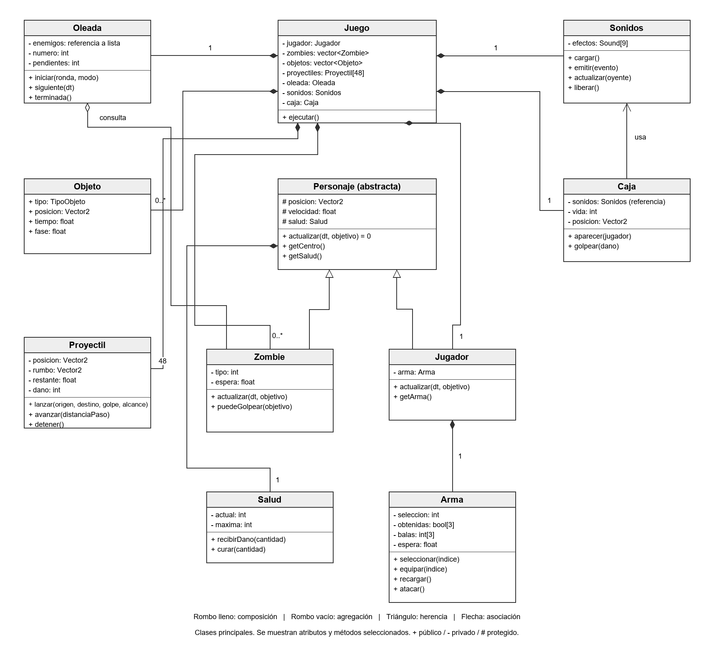

# Informe de avance del videojuego

Universidad Peruana Cayetano Heredia

Curso: Programación Orientada a Objetos

Ciclo: 2026-2


Integrantes

- Kenneth Samir Ramos Espinoza
- Giordano Valentino Valero Bonifacio
- Leonardo Pedro Espinoza Flores
- Leonel Willians Sotelo Mamani

## Resumen

Nuestro equipo está desarrollando un videojuego 2D de supervivencia con oleadas infinitas de zombis.
En este avance presentamos movimiento, combate, armas, cajas y generación de oleadas.
El código está organizado en once clases principales.
Aplicamos herencia, polimorfismo, encapsulamiento, composición, agregación y asociación.
También usamos los patrones Game Loop, para el ciclo del juego, y Object Pool, para reutilizar las balas.
Usamos C++17 y raylib para mostrar las imágenes, leer los controles y reproducir los sonidos.

## Introducción

El juego se llama ZZZombies y corresponde a la temática Ciudad Zombie del curso de Programación Orientada a Objetos. El jugador debe sobrevivir a las oleadas, conseguir armas y recoger botiquines y munición.

El objetivo de este avance es aplicar los conceptos de POO en el funcionamiento del juego. Por ejemplo, el jugador y los zombis heredan de una misma clase, cada personaje tiene su propia salud y las armas controlan su munición.

### Tecnologías utilizadas

- C++17 para programar las clases y la lógica del juego.
- raylib para la ventana, los controles, las imágenes y el audio.
- MSYS2 y MinGW de 32 bits para compilar.
- Git y GitHub para publicar la versión del avance y el informe.
- Archivos PNG para las imágenes y WAV para los sonidos.

## Organización del código

El juego utiliza dos archivos principales. Clases.cpp contiene las clases y las funciones de movimiento, colisiones, combate e interfaz. Variables.h contiene las estadísticas, las rutas de los recursos y la ubicación de los obstáculos del mapa.

Las imágenes y los sonidos están en assets. La biblioteca raylib y su licencia están en vendor. Compilar.cmd genera el ejecutable y Jugar.cmd lo abre.

### Clases principales

| Clase | Qué hace |
|---|---|
| Juego | Controla el menú, la partida, la derrota y las interacciones entre los objetos. |
| Personaje | Guarda la posición, velocidad, animación y salud que comparten el jugador y los zombis. |
| Jugador | Lee el teclado, mueve al jugador y guarda su arma. |
| Zombie | Persigue al jugador y controla el tiempo entre sus golpes. |
| Salud | Guarda la vida actual y máxima. Permite recibir daño y curarse. |
| Arma | Controla las armas obtenidas, la selección, la munición y el tiempo entre ataques. |
| Proyectil | Guarda la posición, dirección, daño y alcance restante de una bala. |
| Objeto | Guarda el tipo, posición y tiempo de un objeto que se puede recoger. |
| Caja | Controla dónde aparece la caja, su vida y el sonido al romperse. |
| Oleada | Controla cuántos zombis aparecen, cada cuánto aparecen y cuándo termina la ronda. |
| Sonidos | Carga, reproduce y libera los efectos de sonido. |

Estas son las once clases principales de la partida. El conteo no incluye las clases que agrupan datos en Variables.h ni la clase auxiliar Elemento, que se usa para ordenar lo que se muestra en pantalla.

### Diagrama de clases



## Aplicación de POO

### Asociación

Caja utiliza Sonidos para reproducir un efecto cuando se rompe. Recibe por referencia el sistema de sonido que ya existe en Juego, por lo que puede usarlo sin crear otro sistema de audio.

### Agregación

Oleada recibe una referencia a la lista de zombis de Juego. La consulta para contar los enemigos vivos y saber cuándo termina una ronda. Los zombis pertenecen a Juego; Oleada consulta esa lista sin copiarla ni controlar su creación.

### Composición

Cada Personaje contiene un objeto Salud y cada Jugador contiene un objeto Arma. La salud se crea junto con el personaje y el arma junto con el jugador. Al reiniciar al jugador también se reinician esos objetos.

### Herencia

Jugador y Zombie heredan de Personaje. Comparten posición, velocidad, salud y animación. El jugador se mueve según el teclado y el zombi calcula una dirección hacia el jugador para perseguirlo. Cada clase implementa su propia actualización.

### Polimorfismo

Personaje declara actualizar como un método virtual puro. Jugador y Zombie implementan ese método con comportamientos diferentes.

La función actualizarPersonaje recibe una referencia a Personaje y llama a actualizar. Durante el combate se usa esa misma función para el jugador y los zombis. Según el objeto recibido, se ejecuta la actualización de Jugador o la de Zombie.

### Encapsulamiento y abstracción

Salud guarda la vida actual y máxima como atributos privados. El resto del juego consulta esos valores con getActual y getMaxima, y los modifica mediante recibirDano y curar. Al recibir daño, la vida no baja de cero. Al usar un botiquín, no supera su máximo.

Arma también tiene atributos privados. Su método atacar revisa el tiempo de espera y las balas disponibles antes de permitir el ataque.

Personaje es una clase abstracta porque tiene un método virtual puro. Define los datos y acciones comunes, mientras que Jugador y Zombie implementan cómo se actualiza cada uno.

### Patrones de diseño

Game Loop: la función ejecutar de Juego repite el mismo ciclo mientras la ventana está abierta. Primero actualiza la lógica con el tiempo transcurrido y después dibuja la pantalla.

Object Pool: Juego crea al inicio un arreglo fijo de 48 proyectiles. Al disparar se usa uno que no esté activo y, al terminar su recorrido, queda libre para el siguiente disparo. Así no se crean ni destruyen balas durante la partida.

## Avance del juego

### Menú y movimiento

El menú permite jugar en modo normal, jugar en modo imposible o salir. Al iniciar, el jugador aparece en el mapa y la cámara lo sigue.

El personaje se mueve con WASD o las flechas. Su movimiento se comprueba por separado en los ejes horizontal y vertical para evitar que atraviese los obstáculos. La dirección se normaliza para que al moverse en diagonal no vaya más rápido.

### Combate y armas

El jugador comienza con una espada. Puede obtener una pistola y un AK al romper cajas y recoger las armas. Al recoger un arma se equipa automáticamente. Después puede cambiar entre las armas obtenidas con las teclas 1, 2 y 3 o con sus casillas en pantalla.

El clic izquierdo ataca hacia el cursor. La barra espaciadora ataca hacia el enemigo vivo más cercano. La espada golpea a corta distancia y las armas de fuego lanzan proyectiles y consumen munición.

Los proyectiles se detienen al golpear un zombi, una caja, un obstáculo o el borde del mapa. Se mueven en pasos pequeños para comprobar los impactos durante su recorrido.

### Cajas y objetos

Al comenzar una oleada aparece una caja si no hay otra activa. La caja se rompe al recibir suficiente daño y deja un objeto: botiquín, munición o un arma que el jugador aún no tiene.

El botiquín recupera hasta cuatro puntos de vida. La munición rellena las armas de fuego obtenidas. Si el jugador no necesita uno de esos objetos, permanece en el suelo hasta que se cumpla su tiempo de duración.

### Zombis y oleadas

Hay tres tipos de zombi. El normal tiene estadísticas intermedias, el rápido tiene más velocidad y menos vida inicial, y el tanque tiene más vida y daño, pero se mueve más lento.

En modo normal, los rápidos pueden aparecer desde la tercera oleada y los tanques desde la quinta. En modo imposible, los tres tipos pueden aparecer desde el inicio, aparecen más enemigos y se reduce la espera entre apariciones. La vida de los zombis aumenta con el número de oleada.

Una oleada termina cuando ya no quedan zombis vivos ni pendientes de aparecer. El botón SKIP permite adelantar la ronda y tiene una espera de tres segundos entre usos. Los enemigos que siguen vivos permanecen en el mapa.

### Interfaz, audio y derrota

La interfaz muestra la vida, las eliminaciones, el número de oleada, la dificultad, los enemigos vivos y pendientes, el arma seleccionada y la munición.

El juego reproduce sonidos al atacar, recibir daño, cambiar de arma y comenzar una oleada. Los gemidos y sonidos de muerte se escuchan cuando los zombis están cerca del jugador.

Cuando la vida llega a cero, el combate se detiene y aparece el mensaje «Has muerto». Desde esa pantalla se puede reiniciar la partida o volver al menú.

### Uso de Git

El proyecto se desarrolló en carpetas locales y se editó con Visual Studio Code. Para esta entrega usamos Git para registrar la versión del avance y subirla a GitHub junto con los recursos y el informe.

El repositorio del proyecto está disponible en [GitHub](https://github.com/leonardoespinoza-ui/Poo-Proyect-Game---Zzzombies).

### Compilación

La versión parcial compiló con C++17 y las opciones de advertencia -Wall, -Wextra y -pedantic, sin errores ni advertencias.

## Conclusiones

El avance permite iniciar una partida, mover al jugador, combatir, recoger objetos y pasar de oleada. También permite volver a jugar otra partida.

Las clases se relacionan con funciones del juego: Salud controla la vida, Arma controla la munición y Oleada controla la aparición de zombis. Jugador y Zombie comparten una clase base y tienen distintas formas de actualizarse.

### Aprendizajes

Aprendimos a decidir cuándo usar herencia y cuándo composición. Jugador y Zombie heredan de Personaje porque ambos son personajes que se mueven y tienen vida. En cambio, un Personaje no es una Salud, sino que tiene una Salud, por eso se usa composición.

También entendimos que el encapsulamiento no consiste solo en poner atributos privados. Salud no tiene un método para cambiar la vida a cualquier valor: solo permite recibir daño y curarse, y cada método respeta los límites de cero y del máximo.

Separar los datos de la lógica facilitó los ajustes. Las estadísticas de armas y zombis están en Variables.h, por lo que se pueden balancear sin modificar las clases.

### Dificultades

Coordinar el trabajo entre integrantes fue la principal dificultad. En algunos momentos hubo versiones distintas del código y de las medidas de las imágenes, y tuvimos que acordar una sola versión antes de la entrega.

Configurar la compilación también tomó tiempo. raylib está compilada para MinGW de 32 bits, por lo que cada computadora necesita el mismo compilador para generar el ejecutable.

Por último, ajustar las colisiones y los proyectiles requirió varias pruebas. Separar el movimiento por ejes y avanzar las balas en pasos pequeños evitó que los personajes y los disparos atravesaran obstáculos o enemigos.

## Anexos

### Actualización durante el combate

Dentro de la función combate se llama a actualizarPersonaje para actualizar al jugador. Después se recorre la lista de zombis y se llama a la misma función para cada uno, pasando el centro del jugador como objetivo.

### Ejecución

Para compilar se utiliza Compilar.cmd, con MinGW de 32 bits instalado en C:\msys64\mingw32. Después se abre Jugar.cmd. Cuando se modifica el código, se vuelve a compilar.

El ejecutable debe estar junto a la carpeta assets. vendor contiene la biblioteca necesaria para compilar y su licencia.

### Fragmentos de código

Los fragmentos son de Clases.cpp. Se omiten algunas líneas con `// ...` para mostrar solo lo relevante.

**Encapsulamiento: clase Salud**

```cpp
class Salud
{
private:
    int actual;
    int maxima;
public:
    Salud(int cantidad = Datos::vidaJugador) : actual(cantidad), maxima(cantidad) {}
    int getActual() const { return actual; }
    int getMaxima() const { return maxima; }
    bool estaVivo() const { return actual > 0; }
    void recibirDano(int cantidad) { actual = std::max(0, actual - cantidad); }
    void curar(int cantidad) { actual = std::min(maxima, actual + cantidad); }
};
```

**Herencia, abstracción y composición: clase Personaje**

```cpp
class Personaje
{
protected:
    Vector2 posicion;
    float velocidad;
    // ...
    Salud salud;                                    // composición
    void mover(Vector2 movimiento, float dt);
public:
    Personaje(Vector2 inicio, float rapidez, int vida) : posicion(inicio), velocidad(rapidez), salud(vida) {}
    virtual ~Personaje() = default;
    virtual void actualizar(float dt, Vector2 objetivo) = 0;   // método virtual puro
    // ...
};

class Jugador : public Personaje
{
private:
    Arma arma;                                      // composición
public:
    void actualizar(float dt, Vector2) override;    // lee el teclado
    // ...
};

class Zombie : public Personaje
{
public:
    void actualizar(float dt, Vector2 objetivo) override;   // persigue al jugador
    // ...
};
```

**Polimorfismo durante el combate**

```cpp
void actualizarPersonaje(Personaje &personaje, float dt, Vector2 objetivo)
{
    personaje.actualizar(dt, objetivo);
}

// dentro de Juego::combate
actualizarPersonaje(jugador, dt, {0, 0});
for (int i = 0; i < int(zombies.size()); i++) {
    actualizarPersonaje(zombies[i], dt, jugador.getCentro());
    // ...
}
```

**Agregación y asociación**

```cpp
class Oleada
{
private:
    const std::vector<Zombie> &enemigos;            // agregación: consulta la lista de Juego
    // ...
};

class Caja
{
private:
    Sonidos &sonidos;                               // asociación: usa el audio de Juego
    // ...
};

// constructor de Juego: entrega sus objetos por referencia
Juego() : oleada(zombies), caja(sonidos) {}
```

**Game Loop**

```cpp
void ejecutar() {
    // ...
    cargar();
    while (!WindowShouldClose() && !salir) {
        actualizar(std::min(GetFrameTime(), 0.05f));
        if (!salir) dibujar();
    }
    liberar();
    CloseWindow();
}
```
