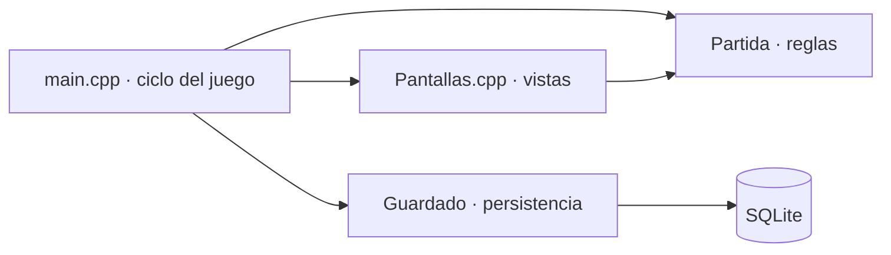

# ZZZombies - El amanecer de los muertos

**Informe final de Programación Orientada a Objetos**  
Universidad Peruana Cayetano Heredia · Ciclo 2026-2

Kenneth Samir Ramos Espinoza, Giordano Valentino Valero Bonifacio, Leonardo Pedro Espinoza Flores y Leonel Willians Sotelo Mamani.

## De qué trata el juego

En ZZZombies eliges un arma y sales a sobrevivir oleadas. Puedes usar una pistola, un AK-47, una espada o una katana. Si peleas de cerca, la espada te da un corazón extra y la katana te da dos. En Imposible tienes un solo corazón con cualquier arma. Nos gusta esa diferencia porque puedes probar el mismo mapa con otra arma y terminar jugando de otra manera.

Desde el avance simplificamos el combate. Quitamos las cajas, la munición y las mejoras de arma para concentrarnos en pelear, decidir cuándo saltar la oleada y elegir tarjetas. También añadimos pausa, efectos para los zombis especiales y un récord local.

## Dos decisiones de la versión final

**Saltar acelera la partida.** El botón se habilita después de cinco segundos. Si lo usas, llegan más zombis y los que quedaban siguen en el mapa. Como las bajas cuentan para las tarjetas, mantienes el progreso aunque adelantes la oleada. En Fácil la primera tarjeta pide 5 bajas y las siguientes piden 7, 9 y 12. En Difícil e Imposible empiezas con 14 y luego necesitas 19, 26 y 35. Cada cifra es el coste de esa tarjeta. El aumento es del 35 %, redondeado y con un tope de 18 bajas extra por mejora.

**El récord se guarda "solo" cuando lo confirmas** Si superas el puntaje anterior, puedes escribir tu nombre y pulsar **Guardar**. SQLite también conserva las monedas, las armas desbloqueadas y el historial de partidas.

## Cómo organizamos el código

| Parte | Responsabilidad | Ejemplo para revisar |
|---|---|---|
| `Partida` | Mantiene el estado y aplica las reglas de combate, oleadas y mejoras. | `elegir` calcula el coste de la siguiente tarjeta. |
| `Guardado` | Maneja el acceso a SQLite. | `comprar` confirma la operación cuando se completan el pago y el desbloqueo. |
| `Pantallas.cpp` | Dibuja las vistas con raylib. | `dibujarPartida` recorta el sprite de relleno de cada barra de vida según la salud del zombi. |
| `main.cpp` | Lee los controles y coordina el juego. | `ejecutar` abre la vista de tarjetas cuando `Partida` indica que hay una disponible. |

El diagrama muestra qué conecta el ciclo principal.

